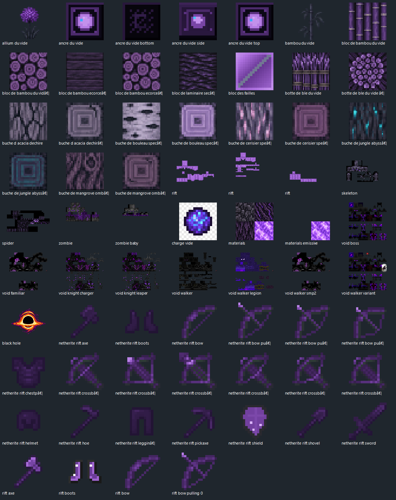

# Corrupted Portal: The Void World — Wiki

> Statut : documentation locale, prête à publier.
> Analyse des JAR universels 0.1.3 réalisée : douze modules MC 1.21 et cinq MC 26. Attention : CurseForge affiche 0.1.1. Complété par le document local de livraison 0.1.3.

Le monde du Vide propose des failles, portails, monstres corrompus, équipement Rift et un compagnon évolutif.

**CurseForge :** https://www.curseforge.com/minecraft/mc-mods/corrupted-portal-the-void-world

**Type :** fabric · **Archive :** CurseForge 0.1.1 ; build locale 0.1.3, MC 1.21.x et 26.x.

## Sommaire

- [Accueil](docs/Accueil.md)
- [Installation](docs/Installation.md)
- [Guide et mécaniques](docs/Fonctionnement.md)
- [FAQ](docs/FAQ.md)
- [Inventaire des archives JAR/ZIP](docs/Inventaire-JAR.md)
- [Sources et limites](docs/Sources-et-verification.md)
- [English overview](docs/English-Overview.md)

Télécharge les fichiers d'installation directement sur CurseForge. Les JAR, ZIP et textures ne sont pas redistribués dans ce wiki.

## Ressources réelles extraites des archives

Les fichiers JAR/ZIP du mod ont été inspectés sans être exécutés. Les pages suivantes présentent les recettes JSON, fonctions, traductions, structures et textures effectivement présentes dans la version indiquée.

- [Atlas technique : versions, structures, butin](docs/Atlas-technique.md)
- [Recettes et crafts du JAR](docs/Recettes-verifiees.md)
- [Objets, blocs, entités et enchantements](docs/Objets-blocs-entites.md)
- [Galerie des textures PNG du mod](docs/Textures-originales.md)
- [Fonctions et règles statiques](docs/Fonctions-analysees.md)

**Référence :** `corrupted-portal-0.1.3-mc1.21-universel.jar`, module `META-INF/jars/corrupted-portal-1.21.11-0.1.3.jar`.

### Aperçu des textures originales

Les fichiers PNG sont extraits du JAR du mod. La planche illustre les ressources brutes, pas l'apparence définitive des blocs et entités dans Minecraft.
