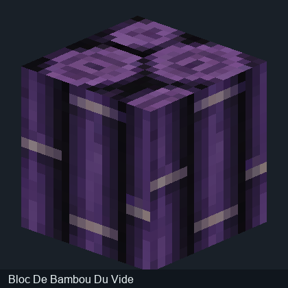
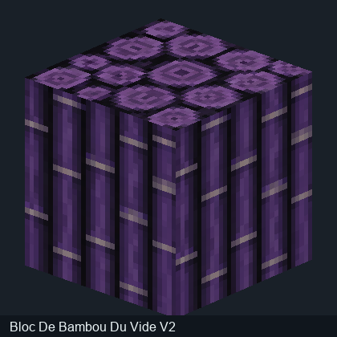

# Diagnostic des textures 3D — Corrupted Portal

Les images initiales n'avaient pas toutes les coordonnées UV correctes. Les aperçus mis à jour utilisent toujours les géométries du JAR audité, mais corrigent le traitement des textures.

## Erreurs vérifiées

- Dans Minecraft Java, les UV des modèles de blocs sont exprimées dans un espace de référence 16 × 16. Un PNG 32 × 32 exige donc de multiplier les coordonnées UV par deux, au lieu de n'utiliser que son quart supérieur gauche.

- Le dépliage des cubes GeckoLib utilise l'ordre est, nord, ouest, sud, pas l'inversion des faces latérales employée par le premier convertisseur.

- Les inversions et les rotations UV sont désormais traitées. Les textures PNG d'origine ne sont pas redessinées.

## Comparaison de la même géométrie JAR

Les modèles de la colonne de gauche sont les anciens aperçus UV1 conservés pour vérification; les modèles de droite sont les nouveaux aperçus UV2.

| Modèle | Avant : projection incorrecte | Après : UV corrigées |

| --- | --- | --- |

| bloc allium du vide |  |  |

| bloc bloc de bambou du vide |  |  |

| bloc ancre du vide |  |  |

## Entités Java

Certaines entités de Corrupted Portal utilisent une géométrie Java et non des fichiers GeckoLib directement lisibles. Leur PNG ne permet pas à lui seul de reconstruire fidèlement la créature. Aucune fausse silhouette n'a été créée.

## Limites importantes

Les rendus logiciels ne sont pas des captures de Minecraft : animations, UV de couches secondaires, éclairage émissif, rotations par blockstates et effets de rendu Java peuvent être différents. Les images ne sont plus de simples PNG dépliés, mais un contrôle dans Blockbench ou Minecraft reste nécessaire pour assurer la correspondance parfaite.

[Galerie des modèles 3D](Modeles-3D.md) · [Accueil](../README.md)
