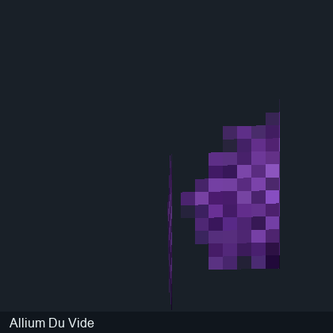
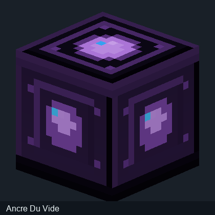

# Corrections des textures des blocs

Les aperçus précédents de **blocs** ne tenaient pas toujours compte du fait que les coordonnées UV Minecraft se définissent sur 16 × 16 unités, même lorsqu'un PNG réel fait 32 × 32 pixels.

Voici des comparaisons concernant uniquement les blocs du JAR 0.1.3.

| Bloc | Ancienne projection | Projection corrigée |
|---|---|---|
| Allium du Vide |  |  |
| Ancre du Vide |  |  |

Aucun rendu de créature n'est inclus dans ce guide : l'apparence des entités personnalisées reste à découvrir via les publications officielles de l'auteur. Les images de blocs sont des aperçus logiciels hors jeu.

[Blocs](Modeles-3D.md) · [Accueil](../README.md)
