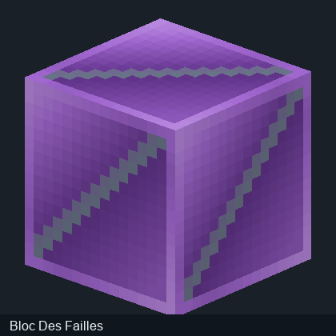
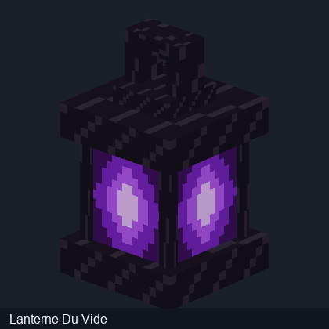

# Modèles 3D — Corrupted Portal

**Ces images montrent les véritables formes 3D reconstruites à partir des modèles contenus dans les JARs et de leurs coordonnées UV.** Ce ne sont plus les planches de textures brutes.

L'aperçu utilise une caméra isométrique, une pose de repos et un éclairage logiciel. Il ne représente pas une capture d'écran de Minecraft : les animations, les shaders, les couches émissives et certaines rotations peuvent varier en jeu.

Les fichiers de modèle natifs extraits du JAR restent accessibles à côté des images ; aucun modèle n'a été inventé à partir du PNG seul.

## Les entités (géométrie GeckoLib)

**Rendu fidèle des entités non disponible depuis ce JAR seul.** Les textures PNG d'entités ne définissent pas une géométrie. Ce mod emploie notamment des modèles codés en Java : nous ne montrons pas de silhouette inventée et ces entités demandent un examen supplémentaire du code de rendu.

## Blocs — modèles JSON Minecraft

| Aperçu rendu en 3D | Bloc / modèle JSON | Eléments |
| --- | --- | ---: |

|  | **Allium Du Vide** · [Modèle de bloc d'origine](../assets/modeles_3d/modeles_blocs/allium_du_vide.json) | 2 |

|  | **Ancre Du Vide** · [Modèle de bloc d'origine](../assets/modeles_3d/modeles_blocs/ancre_du_vide.json) | 1 |

|  | **Bloc De Bambou Du Vide** · [Modèle de bloc d'origine](../assets/modeles_3d/modeles_blocs/bloc_de_bambou_du_vide.json) | 1 |

|  | **Bloc Des Failles** · [Modèle de bloc d'origine](../assets/modeles_3d/modeles_blocs/bloc_des_failles.json) | 1 |

|  | **Lanterne Du Vide** · [Modèle de bloc d'origine](../assets/modeles_3d/modeles_blocs/lanterne_du_vide.json) | 11 |

## Pourquoi conserver également les textures à plat ?

Le rendu en 3D sert à comprendre l'apparence d'un bloc ou d'une créature. Les planches UV sont utiles aux créateurs de mods qui souhaitent vérifier l'application des textures et modifier les ressources. Les deux vues ont donc des utilités différentes.

[Retour au wiki](../README.md) · [Textures UV brutes](Textures-originales.md) · [Recettes](Recettes-verifiees.md)
