# Blocs, plantes et équipements — galerie de Corrupted Portal

Cette galerie illustre uniquement **les blocs et objets** du JAR de référence. Les textures UV, modèles et images des créatures ne sont volontairement pas publiés, afin de préserver la surprise jusqu'aux photographies choisies par l'auteur sur CurseForge.

Les PNG peuvent être utilisés pour identifier les ressources du jeu, mais pour comprendre l'aspect assemblé d'un bloc, consulte [les modèles 3D des blocs](Modeles-3D.md).

## Blocs
| Texture | Nom de fichier | Format PNG |
| --- | --- | --- |
|  | `block/allium_du_vide` | 32 × 32 |
|  | `block/ancre_du_vide` | 16 × 16 |
|  | `block/ancre_du_vide_bottom` | 16 × 16 |
|  | `block/ancre_du_vide_side` | 16 × 16 |
| <a href="../assets/textures/block/ancre_du_vide_top.png">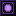</a> | `block/ancre_du_vide_top` | 16 × 16 |
| <a href="../assets/textures/block/bambou_du_vide.png">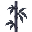</a> | `block/bambou_du_vide` | 32 × 32 |
|  | `block/bloc_de_bambou_du_vide` | 32 × 32 |
|  | `block/bloc_de_bambou_du_vide_top` | 32 × 32 |
| <a href="../assets/textures/block/bloc_de_bambou_ecorce_du_vide.png">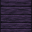</a> | `block/bloc_de_bambou_ecorce_du_vide` | 32 × 32 |
|  | `block/bloc_de_bambou_ecorce_du_vide_top` | 32 × 32 |
| <a href="../assets/textures/block/bloc_de_laminaire_sechee_du_vide.png">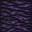</a> | `block/bloc_de_laminaire_sechee_du_vide` | 32 × 32 |
|  | `block/bloc_des_failles` | 16 × 16 |
| <a href="../assets/textures/block/botte_de_ble_du_vide.png">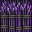</a> | `block/botte_de_ble_du_vide` | 32 × 32 |
|  | `block/botte_de_ble_du_vide_top` | 32 × 32 |
| <a href="../assets/textures/block/buche_d_acacia_dechire.png">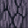</a> | `block/buche_d_acacia_dechire` | 32 × 32 |
| <a href="../assets/textures/block/buche_d_acacia_dechire_top.png">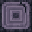</a> | `block/buche_d_acacia_dechire_top` | 32 × 32 |
| <a href="../assets/textures/block/buche_de_bouleau_spectral.png">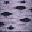</a> | `block/buche_de_bouleau_spectral` | 32 × 32 |
|  | `block/buche_de_bouleau_spectral_top` | 32 × 32 |
| <a href="../assets/textures/block/buche_de_cerisier_spectral.png">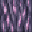</a> | `block/buche_de_cerisier_spectral` | 32 × 32 |
| <a href="../assets/textures/block/buche_de_cerisier_spectral_top.png">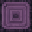</a> | `block/buche_de_cerisier_spectral_top` | 32 × 32 |
|  | `block/buche_de_jungle_abyssale` | 32 × 32 |
|  | `block/buche_de_jungle_abyssale_top` | 32 × 32 |
| <a href="../assets/textures/block/buche_de_mangrove_ombre.png">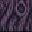</a> | `block/buche_de_mangrove_ombre` | 32 × 32 |
| <a href="../assets/textures/block/buche_de_mangrove_ombre_top.png">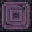</a> | `block/buche_de_mangrove_ombre_top` | 32 × 32 |
## Objets et équipements
| Texture | Nom de fichier | Format PNG |
| --- | --- | --- |
|  | `item/netherite_rift_axe` | 16 × 16 |
|  | `item/netherite_rift_boots` | 16 × 16 |
|  | `item/netherite_rift_bow` | 16 × 16 |
|  | `item/netherite_rift_bow_pulling_0` | 16 × 16 |
|  | `item/netherite_rift_bow_pulling_1` | 16 × 16 |
|  | `item/netherite_rift_bow_pulling_2` | 16 × 16 |
|  | `item/netherite_rift_chestplate` | 16 × 16 |
|  | `item/netherite_rift_crossbow` | 16 × 16 |
|  | `item/netherite_rift_crossbow_arrow` | 16 × 16 |
|  | `item/netherite_rift_crossbow_firework` | 16 × 16 |
|  | `item/netherite_rift_crossbow_pulling_0` | 16 × 16 |
|  | `item/netherite_rift_crossbow_pulling_1` | 16 × 16 |
|  | `item/netherite_rift_crossbow_pulling_2` | 16 × 16 |
|  | `item/netherite_rift_helmet` | 16 × 16 |
|  | `item/netherite_rift_hoe` | 16 × 16 |
|  | `item/netherite_rift_leggings` | 16 × 16 |
|  | `item/netherite_rift_pickaxe` | 16 × 16 |
|  | `item/netherite_rift_shield` | 16 × 16 |
|  | `item/netherite_rift_shovel` | 16 × 16 |
|  | `item/netherite_rift_sword` | 16 × 16 |
|  | `item/rift_axe` | 16 × 16 |
|  | `item/rift_boots` | 16 × 16 |
|  | `item/rift_bow` | 16 × 16 |
|  | `item/rift_bow_pulling_0` | 16 × 16 |

[Accueil du wiki](../README.md) · [Créatures et dangers, sans images](Creatures-et-dangers.md)
